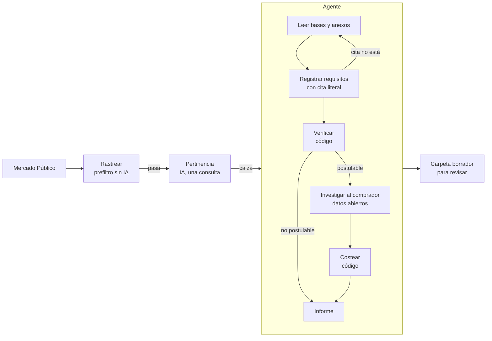

# Agente de compras públicas

Un agente de IA que estudia compras del Estado de Chile en Mercado Público (licitaciones y
Compras Ágiles) y contesta, para cada una, lo que hay que saber antes de gastar horas en una
postulación:

1. **¿Es algo que hacemos?**
2. **¿Podemos postular sin quedar inadmisibles?** Una oferta que no cumple un requisito de
   admisibilidad no se evalúa, y si todas quedan así la compra se declara desierta.
3. **¿A qué precio, y cuánto ganamos?** Frente al tope y a lo que suele adjudicar ese comprador.
4. **¿Qué hay que subir?** Cotización, CV del equipo asignado, propuesta y lista de chequeo.

El agente **nunca envía nada**. Deja todo en `salida/<id>/` para que una persona lo revise,
lo firme y lo suba.

Los datos de `ejemplo/` son ficticios: la organización, las personas, las experiencias y las
compras se inventaron para la demostración.

## Qué hace el agente

Recibe una compra y un conjunto de herramientas, y decide él cómo estudiarla: qué documentos
leer y en qué orden, qué buscar cuando una cita no calza, a qué licitaciones anteriores del
mismo comprador mirar. Así estudió la licitación de ejemplo LIC-DEMO-004 con el modelo real
(2026-10-20, 9 vueltas, USD 0,26):

```text
LIC-DEMO-004: el agente está estudiando la compra
  -> listar_documentos
  -> leer_documento
  -> registrar_requisitos          las 10 citas aparecen literales en las bases
  -> verificar_postulacion         postulable con brechas
  -> ver_equipo
  -> historial_propio              (por tema: sin casos)
  -> historial_propio              (por comprador: 2 casos)
  -> licitaciones_del_comprador
     (rechazada: No puedo sacar la unidad compradora de "LIC-DEMO-004"; pásala en "unidad".)
  -> resultado_licitacion
  -> resultado_licitacion
  -> costear                       competidor estimado con LIC-HIST-01
  -> entregar_informe
```

Los informes completos de los tres estudios reales están en [`ejemplo/estudios/`](ejemplo/estudios/):

| Compra | Veredicto | Lo que hizo el agente | Costo |
|---|---|---|---|
| [CA-DEMO-001](ejemplo/estudios/CA-DEMO-001.md) | Postulable | Estimó la competencia con dos compras del mismo municipio y avisó que el costeo asigna como relatora a quien no cumple el perfil | USD 0,21 |
| [LIC-DEMO-002](ejemplo/estudios/LIC-DEMO-002.md) | No postulable | Citó la cláusula que la deja fuera, no costeó y sugirió entrar como docente de una universidad que postule | USD 0,09 |
| [LIC-DEMO-004](ejemplo/estudios/LIC-DEMO-004.md) | Con brechas | Notó que un intento anterior del comprador quedó desierto y que no se sabe si el monto del historial incluía IVA | USD 0,26 |

Las compras de ejemplo son ficticias y no tienen código de Mercado Público. Por eso el agente no
pudo consultar los datos abiertos en estos estudios. Con una licitación real sí puede.

| Herramienta | Qué hace |
|---|---|
| `listar_documentos`, `leer_documento` | Lee las bases y los anexos por tramos. Un PDF escaneado va entero al modelo |
| `buscar_en_bases` | Busca un texto en todos los documentos, sin distinguir tildes ni mayúsculas |
| `registrar_requisitos` | Guarda lo que exigen las bases, y devuelve las citas que no aparecen literales para que el agente las corrija |
| `ver_equipo` | El equipo, sus títulos y respaldos, y las experiencias de la organización |
| `verificar_postulacion` | Cruza los requisitos con el equipo y da el veredicto. Es código, no IA |
| `historial_propio` | Compras pasadas que la organización registró, con su resultado |
| `licitaciones_del_comprador` | Las licitaciones de la misma unidad compradora en los últimos meses (datos abiertos de ChileCompra) |
| `resultado_licitacion` | Cuántas ofertas recibió una licitación, cuántas descalificó, los montos y a quién adjudicó |
| `costear` | Costo, escenarios de precio, margen y precio recomendado. Es código, no IA |
| `entregar_informe` | El informe final para quien decide |

### Lo que el agente no puede hacer

El agente decide cómo investigar, pero no decide lo que cuesta plata. Las herramientas lo
impiden:

- **No escribe el veredicto.** Sale de `verificar_postulacion`, que es determinista y tiene
  pruebas: el mismo equipo frente a las mismas bases da siempre el mismo resultado. El informe
  lo toma de ahí.
- **No inventa requisitos.** Cada exigencia lleva la frase de las bases de la que sale. Si la
  frase no está, `registrar_requisitos` se la devuelve. Lo que no encuentre queda marcado en el
  informe como cita no verificada.
- **No inventa a la competencia.** Puede proponerle a `costear` un precio de la competencia,
  pero solo citando casos que consultó en ese mismo estudio. Un caso que no consultó se rechaza.
- **No se salta pasos.** `entregar_informe` se niega si no hay veredicto, o si la compra es
  postulable y no se costeó.
- **Lo que no tiene respaldo documental queda parcial**, no cumple: tener las horas de docencia
  sin los certificados no sirve en una evaluación.

## Probarlo

Sin clave de API, la demo corre el mismo análisis sin el agente: reglas en vez de IA, y los
requisitos que la IA habría extraído, guardados junto a cada compra.

```bash
npm install
npm run demo
```

```text
5 compras rastreadas, 4 pasan el prefiltro.

- CA-DEMO-001 POSTULABLE (100/100). Precio recomendado $ 2.411.764 neto, margen $ 730.964.
- CA-DEMO-003 no calza (33/100): Modo simulado: nombra taller.
- LIC-DEMO-002 calza (67/100) pero NO es postulable: Quedaría inadmisible por: Institucional:
  Universidad acreditada por 4 años o más.
- LIC-DEMO-004 POSTULABLE CON BRECHAS (100/100). Precio recomendado $ 11.495.798 neto,
  margen $ 2.411.502.
```

| Compra | Qué pasa | Por qué |
|---|---|---|
| CA-DEMO-001 | Postulable | El equipo cubre el perfil del relator y hay dos experiencias con orden de compra |
| LIC-DEMO-002 | Calza, pero no se postula | Las bases admiten solo universidades acreditadas: la oferta quedaría inadmisible |
| CA-DEMO-003 | No calza | Dice "taller", pero es de cocina. El prefiltro la deja pasar y el juicio de pertinencia la saca |
| LIC-DEMO-004 | Postulable con brechas | Falta un especialista (se propone un externo) y una experiencia solo tiene certificado, que estas bases no aceptan |
| CA-DEMO-005 | Descartada sin IA | Es un coffee break: el prefiltro la descarta antes de gastar un token |

Con clave de API, el agente estudia la compra:

```bash
cp .env.example .env              # y pon ANTHROPIC_API_KEY
npm run agente -- estudiar LIC-DEMO-004
```

Deja `salida/LIC-DEMO-004/informe-agente.md` con el veredicto, el resumen, lo que hay que
revisar a mano y la bitácora de cada herramienta que usó.

## Cómo funciona



| Paso | Archivo | IA |
|---|---|---|
| Rastrear | [`src/agentes/rastreador.ts`](src/agentes/rastreador.ts) | No: descarta exclusiones, montos fuera de rango, compras cerradas y las que no nombran ninguna palabra clave |
| Pertinencia | [`src/agentes/pertinencia.ts`](src/agentes/pertinencia.ts) | Una consulta con esfuerzo bajo, para no gastar el agente en lo que no calza |
| Agente | [`src/agente/agente.ts`](src/agente/agente.ts), [`src/agente/herramientas.ts`](src/agente/herramientas.ts) | El modelo con herramientas, con un tope de 40 vueltas |
| Verificación | [`src/agentes/requisitos.ts`](src/agentes/requisitos.ts) | No |
| Oferta | [`src/agentes/economico.ts`](src/agentes/economico.ts) | No. Ver [`docs/oferta-economica.md`](docs/oferta-economica.md) |
| Carpeta | [`src/agentes/postulacion.ts`](src/agentes/postulacion.ts) | Solo el borrador de la propuesta, que marca con `[COMPLETAR]` lo que no está en los datos |

Las fuentes:

- **Licitaciones abiertas:** API oficial de Mercado Público, con un ticket gratuito
  ([api.mercadopublico.cl](https://api.mercadopublico.cl)).
- **Compras Ágiles:** el buscador público, que no tiene API oficial. Se lee con Playwright y es
  lo primero que se rompe si el sitio cambia.
- **Historial de compradores:** los datos abiertos OCDS de ChileCompra, sin ticket. Traen las
  ofertas de cada licitación (monto, válida o descalificada) y la adjudicación. No hay listado
  por comprador, así que se recorre el listado mensual y se filtra por el prefijo del código, que
  es la unidad compradora. La primera consulta de un mes tarda cerca de medio minuto; después
  queda en caché.

## Usarlo con tus datos

1. Copia `ejemplo/` a `datos/` (está en `.gitignore`) y reemplaza los valores. El formato de
   cada archivo está en [`docs/datos.md`](docs/datos.md).
2. Copia `.env.example` a `.env` y completa las claves.
3. Corre:

```bash
npm run agente -- rastrear --datos datos --fuente licitaciones   # o compras-agiles
npm run agente -- todo --datos datos --fuente licitaciones       # rastrea y el agente estudia lo que calza
npm run agente -- estudiar <id> --datos datos                    # una compra; sus PDFs en datos/compras/<id>/
```

El resultado de cada etapa queda en `salida/<id>/`. Volver a correr no vuelve a llamar a la IA;
`--rehacer` lo fuerza. `--sin-red` deja al agente sin los datos abiertos.

## Pendiente

- El costeo valoriza las horas por rol genérico (senior, consultor) y no por la persona que la
  verificación asignó a cada perfil. Lo detectó el propio agente en CA-DEMO-001.
- Los respaldos (CV, títulos, certificados, órdenes de compra) se declaran como sí o no en los
  `.yaml`. Falta una carpeta para los PDF, que el agente compruebe que existen y que la carpeta
  de postulación los adjunte.

## Desarrollo

```bash
npm test          # vitest
npm run typecheck # tsc --noEmit
```

Las pruebas del agente corren contra un modelo falso: un servidor local que responde como la API
de Anthropic con un guion que se porta mal a propósito (una cita inventada, un informe antes de
verificar, evidencia que no consultó). La prueba exige que las herramientas lo frenen.

Cada prueba se midió poniendo el defecto a mano y comprobando que cae. La cabecera de cada archivo
en `test/` dice qué defecto se probó y cuántas pruebas cayeron.

El modelo es `claude-opus-5-5`, con pensamiento adaptativo, el perfil de la organización en caché
entre compras y el tool runner del SDK de Anthropic.

## Licencia

MIT.
