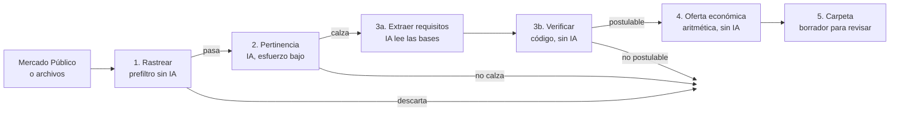

# Agente de compras públicas

Un agente que revisa las compras del Estado de Chile en Mercado Público (licitaciones y
Compras Ágiles) y, para cada una, contesta cuatro preguntas antes de que alguien gaste horas
en una postulación:

1. **¿Es algo que hacemos?** La IA lee la compra y la compara con el perfil de la organización.
2. **¿Podemos postular sin quedar fuera?** La IA extrae los requisitos de las bases y el código
   los cruza con el equipo, las experiencias y los papeles de la organización.
3. **¿A qué precio, y cuánto ganamos?** Costeo por horas y roles, escenarios de precio frente
   al tope y a la competencia estimada, y el margen de cada uno.
4. **¿Qué hay que subir?** Arma un borrador de la carpeta: cotización, CV del equipo asignado,
   propuesta técnica y lista de chequeo.

El agente **nunca envía nada**. Deja todo en `salida/<id>/` para que una persona lo revise,
lo firme y lo suba. Quien postula declara bajo su responsabilidad.

Los datos de `ejemplo/` son ficticios: la organización, las personas, las experiencias y las
cinco compras se inventaron para la demostración.

## Probarlo en un minuto (sin API ni costo)

```bash
npm install
npm run demo
```

```text
5 compras rastreadas, 4 pasan el prefiltro.

- CA-DEMO-001 POSTULABLE (100/100). Precio recomendado $ 2.411.764 neto, margen $ 730.964.
- CA-DEMO-003 no calza (33/100): Modo simulado: nombra taller.
- LIC-DEMO-002 calza (67/100) pero NO es postulable: Quedaría inadmisible por: Institucional:
  Universidad acreditada por 4 años o más.
- LIC-DEMO-004 POSTULABLE CON BRECHAS (100/100). Precio recomendado $ 11.495.798 neto,
  margen $ 4.391.502.
```

Cada caso muestra una parte del agente:

| Compra | Qué pasa | Por qué |
|---|---|---|
| CA-DEMO-001 | Postulable | El equipo cubre el perfil del relator y hay dos experiencias con orden de compra |
| LIC-DEMO-002 | Calza, pero no se postula | Las bases admiten solo universidades acreditadas: la oferta quedaría inadmisible |
| CA-DEMO-003 | No calza | Dice "taller", pero es de cocina. El prefiltro la deja pasar y el juicio de pertinencia la saca |
| LIC-DEMO-004 | Postulable con brechas | Falta un especialista (se propone un externo) y una de las experiencias solo tiene certificado, que estas bases no aceptan |
| CA-DEMO-005 | Descartada sin IA | Es un coffee break: el prefiltro la descarta por exclusión antes de gastar un token |

Abre `salida/LIC-DEMO-004/resumen.md` para ver el detalle: cada requisito con su estado, la
frase de las bases de la que salió y la tabla de escenarios de precio.

## Cómo funciona



| Etapa | Archivo | IA | Qué decide |
|---|---|---|---|
| 1. Rastrear | [`src/agentes/rastreador.ts`](src/agentes/rastreador.ts) | No | Descarta exclusiones, montos fuera de rango, compras cerradas y las que no nombran ninguna palabra clave |
| 2. Pertinencia | [`src/agentes/pertinencia.ts`](src/agentes/pertinencia.ts) | Sí | Si el servicio es algo que la organización hace hoy (0 a 100) |
| 3. Requisitos | [`src/agentes/requisitos.ts`](src/agentes/requisitos.ts) | Lee sí, decide no | Qué exigen las bases y si el equipo y la organización lo cumplen |
| 4. Oferta | [`src/agentes/economico.ts`](src/agentes/economico.ts) | No | Costo, escenarios de precio, margen y precio recomendado |
| 5. Carpeta | [`src/agentes/postulacion.ts`](src/agentes/postulacion.ts) | Solo el borrador de la propuesta | Qué documentos armar y qué falta |

### Por qué la IA lee pero no decide

Una oferta que no cumple un requisito de admisibilidad no se evalúa: queda inadmisible, y si
todas quedan así la compra se declara desierta. Equivocarse ahí cuesta las horas de la
postulación y, para el organismo, un proceso perdido. Por eso la etapa 3 está partida en dos:

- **Extraer** (IA): el modelo lee las bases (texto o PDF) y devuelve cada exigencia en un
  esquema fijo, con la frase literal de la que sale. Si esa frase no aparece en las bases, el
  requisito se marca "cita no verificada" y va a revisión humana.
- **Verificar** (código): cada perfil exigido se cruza con el equipo (título, semestres, grado,
  años, horas de docencia), cada persona cubre un solo perfil, la experiencia cuenta solo si
  está dentro de la ventana de años y tiene un respaldo que las bases aceptan. El resultado es
  determinista y tiene pruebas.

Lo que no tiene respaldo documental queda **parcial**, no **cumple**: tener las horas de
docencia sin los certificados no sirve en una evaluación.

### Cómo se calcula el precio

Ver [`docs/oferta-economica.md`](docs/oferta-economica.md). En corto: el costo sale de las
horas por rol de cada tipo de servicio, más la preparación de la postulación, los costos
directos, una contingencia y el costo financiero de la garantía. El precio de la competencia
se estima con la mediana de compras pasadas parecidas. El precio recomendado es el más alto
que ya obtiene el puntaje de precio completo: bajar más solo regala margen.

## Usarlo con tus datos

1. Copia `ejemplo/` a `datos/` (está en `.gitignore`) y reemplaza los valores. El formato de
   cada archivo está en [`docs/datos.md`](docs/datos.md).
2. Copia `.env.example` a `.env` y pon tu `ANTHROPIC_API_KEY`. Para licitaciones, pide un
   ticket gratuito en [api.mercadopublico.cl](https://api.mercadopublico.cl).
3. Corre:

```bash
# Rastrear licitaciones activas (API oficial) o Compras Ágiles (necesita Playwright)
npm run agente -- rastrear --datos datos --fuente licitaciones
npm run agente -- rastrear --datos datos --fuente compras-agiles

# Todo el flujo sobre las compras que pasan
npm run agente -- todo --datos datos --fuente licitaciones

# Una compra puntual: deja sus PDFs en datos/compras/<id>/ y su JSON en datos/compras/
npm run agente -- evaluar <id> --datos datos
npm run agente -- costear <id> --datos datos
npm run agente -- armar <id> --datos datos
```

Cada etapa queda guardada en `salida/<id>/<etapa>.json`. Volver a correr no vuelve a llamar a
la IA ni a pagar tokens; `--rehacer` lo fuerza. La verificación y la oferta se recalculan
siempre, porque no cuestan nada y dependen de los datos vigentes del equipo.

## Lo que no hace

- No envía ofertas ni firma nada.
- No inventa experiencias, títulos ni cifras: la propuesta técnica marca con `[COMPLETAR]` lo
  que no está en los datos.
- No reemplaza la lectura de las bases. Le dice a una persona dónde mirar primero.
- La fuente de Compras Ágiles usa el buscador público de Mercado Público, que no tiene API
  oficial. Si el sitio cambia, es lo primero que se rompe.

## Desarrollo

```bash
npm test          # vitest
npm run typecheck # tsc --noEmit
```

Cada prueba se midió poniendo el defecto a mano y comprobando que cae: la cabecera de cada
archivo en `test/` dice qué mutación se probó y cuántas pruebas cayeron.

El modelo es `claude-opus-5-5` (en [`src/llm.ts`](src/llm.ts)), con salida estructurada
validada con Zod, prompt caching del perfil de la organización y esfuerzo bajo para clasificar
y alto para leer bases.

## Licencia

MIT.
